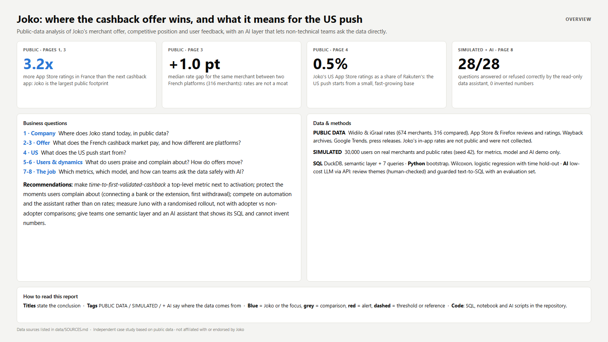
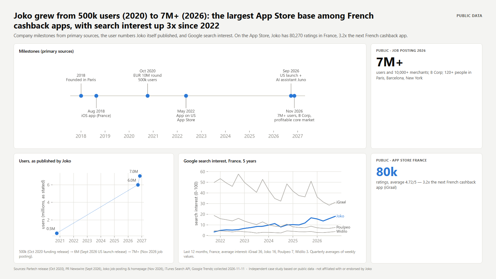
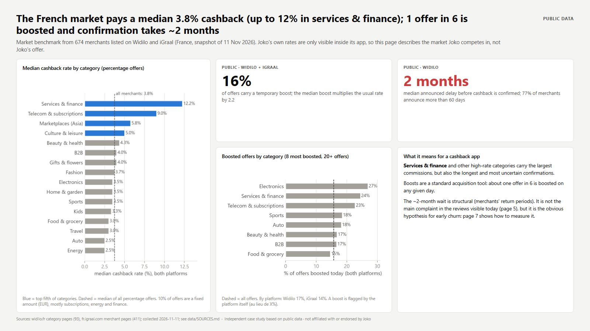
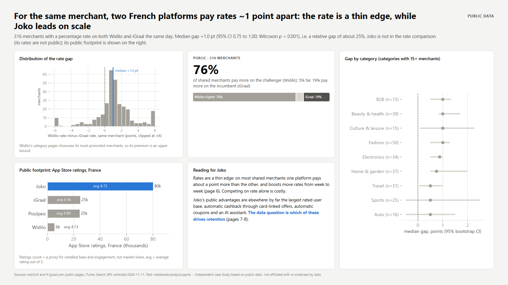
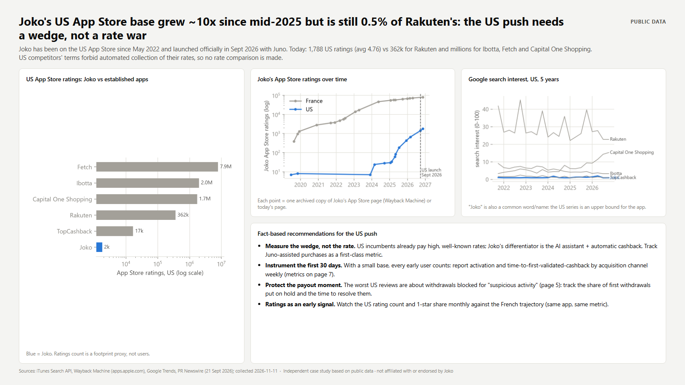
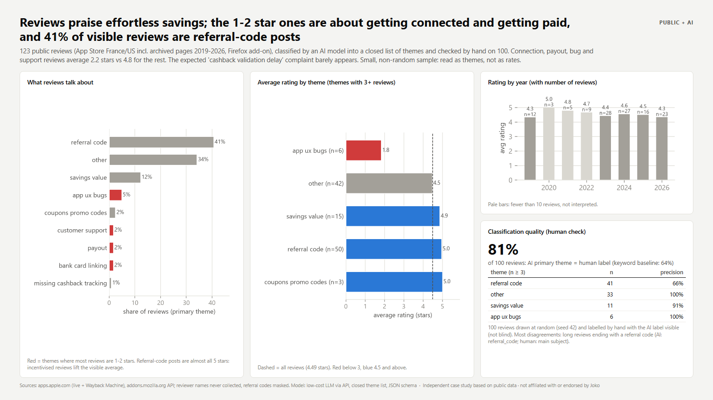
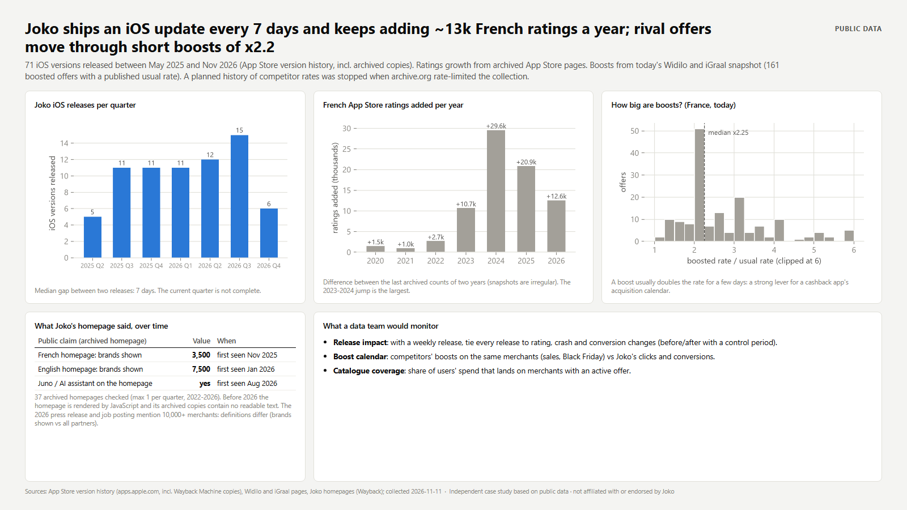
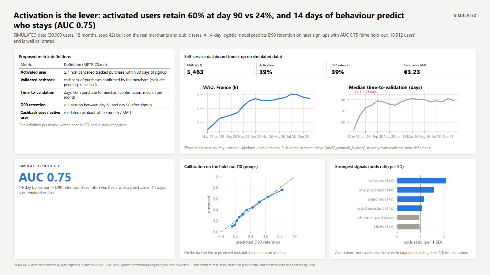
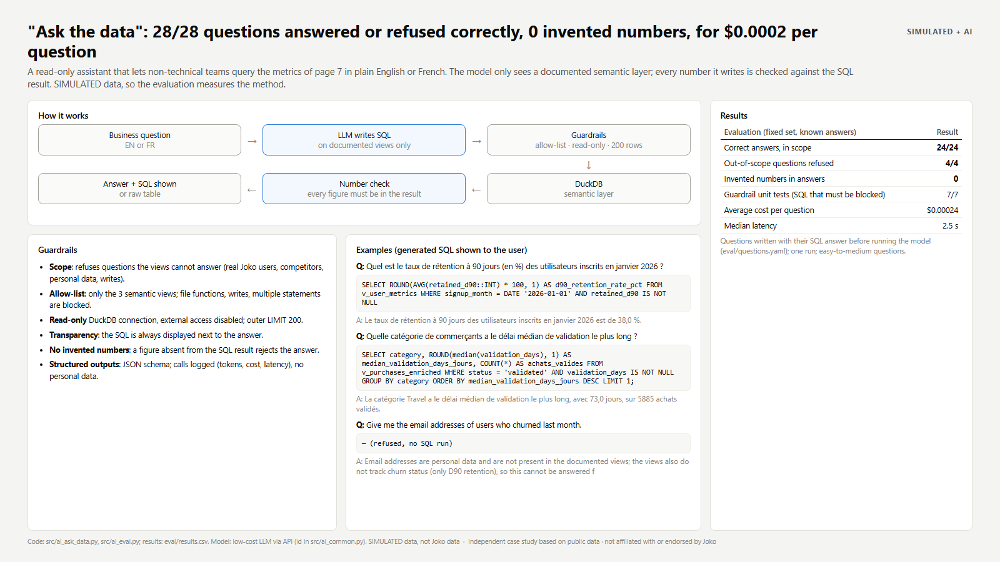

# Joko: where the cashback offer wins, and what it means for the US push

Public-data analysis of Joko's merchant offer, competitive position and user feedback, with an AI layer that lets non-technical teams ask the data directly.

**Full report (10 pages): [docs/Joko_DataCaseStudy.pdf](docs/Joko_DataCaseStudy.pdf)**

Independent case study based on public data · not affiliated with or endorsed by Joko.

## Key results
- **Largest public footprint in France.** Joko has 80,270 App Store ratings in France (4.72/5), 3.2x the next French cashback app. Published users went from 500k (2020) to 7M+ (2026). *(PUBLIC DATA)*
- **The rate is a thin edge.** On 316 merchants listed on two French cashback sites the same day, rates differ by a median +1.0 point (95% bootstrap CI 0.75 to 1.0; Wilcoxon p < 0.001); the challenger pays more on 76% of them. *(PUBLIC DATA)*
- **The US push starts small but fast.** Joko's US App Store ratings grew about 10x since mid-2025 (183 to 1,788), yet that is still 0.5% of Rakuten's. *(PUBLIC DATA)*
- **A data assistant that cannot invent numbers.** "Ask the data" answered or refused 28/28 evaluation questions correctly, with 0 invented numbers, at $0.00024 per question. *(SIMULATED + AI)*



## Questions and answers
| # | Question | Data | Answer |
|---|---|---|---|
| 1 | Where does Joko stand today? | Press releases, job posting, App Store, Google Trends (PUBLIC) | 7M+ users and 10,000+ merchants (2026); the largest App Store base among French cashback apps; French Google search interest up about 3x since 2022 (ahead of Poulpeo since 2024, still about half of iGraal's). |
| 2 | What does the French market pay? | 674 merchants on Widilo and iGraal (PUBLIC) | Median 3.8% cashback, much higher in services and telecom; 16% of offers are boosted (x2.2 on median); Widilo announces ~2 months before cashback is confirmed. Joko's own rates are only visible inside its app and were not collected. |
| 3 | How different are platforms on the same merchant? | 316 paired merchants (PUBLIC) | +1.0 pt median gap, about 25% of the rate. Rates are easy to match; scale and automation are where Joko leads. |
| 4 | What does the US push start from? | App Store ratings and archives, Google Trends (PUBLIC) | 1,788 US ratings vs 362k for Rakuten and millions for Ibotta, Fetch and Capital One Shopping; fast growth since mid-2025. |
| 5 | What do users say? | 123 public reviews, AI-classified, 100 checked by hand (PUBLIC + AI) | Praise for effortless savings; 1-2 star reviews are about connecting the bank or extension, blocked withdrawals and support. 41% of visible reviews are referral-code posts (almost all 5 stars). Validation delays barely appear. |
| 6 | What moves over time? | App Store version history and archives, today's boosts, Joko homepages (PUBLIC) | Joko ships an iOS update every 7 days (71 versions in 18 months); French ratings grew fastest in 2023-2024; competitors' boosts roughly double a rate (median x2.25); Juno appears on Joko's homepage from Aug 2026. |
| 7 | Which metrics, which model? | 30,000 simulated users (SIMULATED) | Activated users retain 60% at day 90 vs 24%; a 14-day logistic model predicts D90 retention with AUC 0.75 on later sign-ups and is well calibrated. |
| 8 | Can teams ask the data safely with AI? | Same + a low-cost LLM via API (SIMULATED + AI) | 24/24 in-scope answers correct, 4/4 out-of-scope questions refused, 7/7 guardrail tests, 0 invented numbers. |

| | |
|---|---|
|  |  |
|  |  |
|  |  |
|  |  |

## Method
```
src/collect_*.py         polite collection of public data (dated raw snapshots, git-ignored)
src/match_merchants.py   merchant matching across platforms (normalised name, fuzzy + manual review)
src/build_public_tables.py  clean PUBLIC tables -> data/public/
src/simulate.py          SIMULATED users / events / purchases / payouts (seed 42) -> data/simulated/
sql/                     DuckDB: semantic layer (00) + 7 analysis queries -> data/output/
notebooks/analysis.ipynb bootstrap CI + Wilcoxon, ratings by period, retention model, assistant selection bias
src/ai_*.py              review themes, "Ask the data", evaluation
src/build_report.py      HTML pages + charts -> PDF (headless Edge) and docs/img/
```
- **Merchant matching**: 407 exact matches on normalised names, 7 fuzzy candidates reviewed by hand (4 accepted, 3 rejected), so 411 of 674 Widilo merchants (61%) were found on iGraal and 353 (52%) had an active rate on both sites that day. The merchant domain is not published by both sites, so domain matching was not possible.
- **Statistics**: paired gaps with a 10,000-resample bootstrap CI for the median and a Wilcoxon signed-rank test; averages on fewer than 10 reviews are not interpreted.
- **Retention model**: logistic regression on first-14-day behaviour, trained on sign-ups May 2025 - Jan 2026 and tested on Feb - Jul 2026 (time hold-out); AUC and a 10-group calibration table.
- **Selection bias demo**: in the simulation, the AI assistant truly raises purchase frequency by +10%. Comparing adopters with non-adopters gives +86%; adjusting for first-week engagement gives +33%. Only an A/B test (or randomised rollout) answers this on real data.
- **Metric definitions**: [METRICS.md](METRICS.md).

## The AI part
**Review themes (PUBLIC + AI).** A recent low-cost LLM (model id in `src/ai_common.py`) classifies each review into a closed list of 11 themes (JSON schema with an enum, so it cannot invent a theme). 100 reviews were labelled by hand (not blind): the AI agrees with the human label on 81% of them, vs 64% for a keyword baseline. Most disagreements are long genuine reviews that end with a referral code. Details: `eval/review_validation_summary.json`, `eval/review_validation_confusion.csv`.

**"Ask the data" (SIMULATED + AI).** A business question in English or French becomes one SQL query on a documented semantic layer (`sql/00_semantic_layer.sql`). Guardrails:
1. out-of-scope questions are refused (real Joko figures, competitors, personal data, writes);
2. allow-list of the 3 semantic views; file functions, writes and multiple statements are blocked;
3. read-only DuckDB connection with external access disabled, outer `LIMIT 200`;
4. the generated SQL is always shown;
5. every number in the written answer must appear in the SQL result, or the answer is rejected (self-tested with a fabricated answer).

**Evaluation** (`eval/questions.yaml`, reference answers written in SQL by hand before running the model):

| Measure | Result |
|---|---|
| In-scope questions answered correctly | 24/24 |
| Out-of-scope questions refused | 4/4 |
| Invented numbers | 0 |
| Guardrail unit tests | 7/7 |
| Average cost per question | $0.00024 |
| Median latency | 2.5 s |

Limits: one run, easy-to-medium questions written by the author, simulated data. The current model no longer accepts a temperature parameter, so outputs are constrained with fixed prompts, low effort and strict JSON schemas instead. Calls are logged locally (tokens, cost, latency; no personal data).

## How to run
```bash
python -m venv .venv
.venv\Scripts\pip install -r requirements.txt          # Windows (use .venv/bin on macOS/Linux)
copy .env.example .env                                 # then add your API key (only for the AI steps)

python src/collect_competitors.py      # public rates (Widilo, iGraal) - ~30 min, polite
python src/collect_appstore.py         # App Store + Firefox reviews and ratings (incl. Wayback)
python src/collect_wayback.py home     # archived Joko homepages
python src/collect_trends.py           # Google Trends
python src/match_merchants.py          # fuzzy candidates -> review data/public/merchant_match_review.csv
python src/match_merchants.py fetch
python src/build_public_tables.py
python src/simulate.py
python src/run_sql.py
jupyter nbconvert --to notebook --execute --inplace notebooks/analysis.ipynb
python src/ai_review_themes.py ; python src/ai_review_validation.py
python src/ai_eval.py                  # without a key: "evaluation pending"
python src/build_report.py             # needs Microsoft Edge or Google Chrome
```
The derived tables are committed, so `run_sql.py`, the notebook and `build_report.py` run without collecting again.
Ask a question: `python src/ai_ask_data.py "Quel est le taux d'activation des utilisateurs inscrits en 2025 ?"`

## Sources
Every public figure is listed with its URL and collection date in [data/SOURCES.md](data/SOURCES.md), including the sources that were checked and **not** used (terms of use or robots.txt). The assumptions of the simulated data are in [data/ASSUMPTIONS.md](data/ASSUMPTIONS.md).

## Limits
- Joko's own cashback rates are only visible inside its app; they were not collected, so the rate analysis describes the market Joko competes in.
- One-day rate snapshot; Widilo's category pages show its most visible (often boosted) merchants.
- Reviews are a small, non-random sample; App Store ratings counts are footprint proxies, not users or market share.
- Archived pages are sparse and irregular; the Joko homepage is JavaScript-rendered before 2026 and has no readable archived text. archive.org rate-limited the collection after ~100 pages, so a planned history of competitor rates was not collected.
- Pages 7-8 use simulated data: they demonstrate methods and say nothing about Joko's real users.

## Methods note on AI
AI-assisted workflow: I used Claude, mainly to write scripts faster. I drove the project: I defined the questions, chose and validated the data sources, made the analytical decisions and checked every result.
